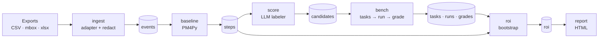

# Evenpoint — Technical Architecture

_Status: proposed design for v0. Companion to [overview.md](overview.md) (what and why), [class-diagram.md](class-diagram.md) (classes and modules) and [competitor-research.md](competitor-research.md) (landscape and roadmap)._

## Design principles

1. **Local-first.** One Python package, one DuckDB file per project. No server, no account, no telemetry.
2. **Measure, don't guess.** Deterministic numbers (process mining) come first. LLMs are used only to label steps and to be tested.
3. **Every number is traceable.** Every prompt, output, grade and price used ends up in the same DuckDB file, so a report can be audited or reproduced.
4. **Reuse before building.** PM4Py for process mining, LiteLLM for model calls and prices, DuckDB for storage. Evenpoint's own code is the glue, the scoring and the ROI.
5. **Stages are restartable.** Each stage reads tables and writes tables. A failed or changed stage reruns without redoing the earlier ones.

## Tech stack

| Concern | Choice | Why |
|---|---|---|
| Language | Python 3.12, packaged with `uv` | PM4Py, DuckDB and LiteLLM are all Python |
| Storage + trace store | DuckDB (single file) | Fast SQL over CSV-sized data, zero setup |
| Process mining | PM4Py | Standard open-source library, Apache 2.0 |
| Model calls | LiteLLM | One API for OpenAI, Anthropic, Gemini, Ollama |
| Pricing catalog | LiteLLM's `model_prices_and_context_window.json`, snapshotted per run | Maintained upstream; snapshot keeps runs reproducible |
| Config | YAML (PyYAML) + dataclasses | Human-editable, no schema framework needed |
| Output validation | `jsonschema` | Schema grader and LLM-labeler output checks |
| CLI | Typer | Small, typed, good help text |
| Report | Jinja2 → single self-contained HTML file | PDF via the browser's print, no PDF library |
| PII redaction | Regex rules (email, phone, card, IBAN, URLs with tokens) + names from actor columns | Optional Presidio plug-in later if regex isn't enough |
| Stats | numpy (already pulled in by PM4Py/pandas) | Bootstrap confidence intervals |

Deliberately **not** used in v0: a web framework, a task queue, an ORM, promptfoo (Node runtime for a Python tool), a hosted backend.

## Pipeline



Every box writes to the same project database: `.evenpoint/project.duckdb`.

## Repository layout

```
evenpoint/
├── pyproject.toml
├── evenpoint/
│   ├── cli.py            # Typer entry point: init, run, bench, report, rerun
│   ├── config.py         # load + validate evenpoint.yaml into dataclasses
│   ├── db.py             # DuckDB connection, table DDL, run ids
│   ├── redact.py         # PII redaction rules
│   ├── adapters/         # one file per source, each exposes read(path, mapping)
│   │   ├── csv_generic.py
│   │   ├── zendesk.py
│   │   ├── jira.py
│   │   └── mbox.py
│   ├── baseline.py       # PM4Py: process map, step times, handoffs, rework
│   ├── score.py          # LLM step labeler + candidate ranking
│   ├── bench/
│   │   ├── tasks.py      # sample records → test cases
│   │   ├── runner.py     # LiteLLM calls, retries, cost + latency capture
│   │   └── graders.py    # schema, exact match, LLM judge, human CSV round trip
│   ├── roi.py            # net hours, cost, payback, CIs, don't-automate list
│   └── report/
│       ├── render.py
│       └── template.html.j2
├── bizbench/             # 15–20 public sample workflows (data + config)
├── tests/
└── docs/
```

## Data model (DuckDB)

All tables carry `run_id` so several runs can live in one project file and be compared.

```sql
-- 2. Normalize: the event log
events(
  run_id      TEXT,
  case_id     TEXT,      -- ticket id, issue key, deal id, email thread id
  activity    TEXT,      -- "created", "assigned", "first_reply", "tagged:billing", "solved"
  ts          TIMESTAMP,
  actor       TEXT,      -- redacted to a stable pseudonym (agent_017)
  source      TEXT,      -- zendesk | jira | mbox | csv
  payload     JSON       -- redacted text + fields needed to build benchmark tasks
)

-- 3. Baseline: one row per activity (step)
steps(
  run_id, activity,
  volume_per_month     DOUBLE,
  median_minutes       DOUBLE,  -- time spent in the step, from timestamps or config override
  minutes_source       TEXT,    -- 'timestamps' | 'config' (estimated by the user)
  handoff_rate         DOUBLE,
  rework_rate          DOUBLE,
  baseline_hours_month DOUBLE   -- volume × minutes / 60
)

-- 4. AI-fit scoring
candidates(
  run_id, activity,
  repetitive INT, structured INT, risk INT,   -- 1–5 rubric
  task_type  TEXT,   -- classify | extract | draft
  fit_score  DOUBLE,
  rank       INT,
  reason     TEXT
)

-- 5. Benchmark
tasks(run_id, task_id, activity, case_id, input JSON, expected JSON, task_type)
runs(run_id, task_id, model, prompt TEXT, output TEXT,
     input_tokens INT, output_tokens INT, cost_usd DOUBLE,
     latency_ms INT, error TEXT, created_at TIMESTAMP)
grades(run_id, task_id, model, grader TEXT, passed BOOL, score DOUBLE, note TEXT)

-- 6. ROI
roi(run_id, activity, model, mode,           -- mode: auto | draft_review | triage
    net_hours_month DOUBLE, net_hours_low DOUBLE, net_hours_high DOUBLE,
    ai_cost_month DOUBLE, payback_months DOUBLE,
    verdict TEXT, reason TEXT)               -- verdict: automate | review | dont_automate

-- Reproducibility
run_meta(run_id, started_at, config_yaml TEXT, pricing_snapshot JSON, evenpoint_version TEXT)
```

The `runs` + `grades` tables **are** the trace store from the v0 diagram.

## Stage details

### 1. Ingest

An adapter is a function, not a class:

```python
def read(path: Path, mapping: dict[str, str]) -> pd.DataFrame:
    """Return columns: case_id, activity, ts, actor, payload (dict)."""
```

- `csv_generic` covers anything once the user maps columns in `evenpoint.yaml`. Named adapters (`zendesk`, `jira`) just ship a default mapping and derive activities from status/field columns.
- **Known limit:** a plain Zendesk ticket CSV has one row per ticket, not one per event. The adapter derives a small event set from timestamp columns (`created_at`, `assigned_at`, `initially_assigned_at`, `solved_at`) and treats tags/groups as activities. Full per-event history needs the audit export; supported later, not required for v0.
- `mbox`: thread by `Message-ID` / `In-Reply-To`; each message is an event, the thread is the case.
- Redaction runs inside ingest, before anything is written to DuckDB. Raw exports are never copied into the project file.

### 2. Normalize

Pure SQL: validate required columns, drop rows without `case_id`/`ts`, dedupe, write `events`. A **data-quality summary** (row counts, missing timestamps, cases with one event, date range) is written to the report so a bad export is visible.

### 3. Baseline

PM4Py on the `events` table:

- directly-follows graph → process map and handoffs
- per-activity duration (time from previous event in the case) → `median_minutes`
- repeated activities within a case → `rework_rate`

Step duration from timestamps includes waiting time, which overstates work time. So `evenpoint.yaml` can override minutes per step, and `minutes_source` records which one was used. The report shows both.

### 4. AI-fit scoring

For each step above a volume threshold, the labeler gets the step's stats plus ~10 redacted sample payloads and returns JSON validated with `jsonschema`:

```json
{"repetitive": 4, "structured": 5, "risk": 2, "task_type": "classify",
 "reason": "Tags are chosen from a fixed list of 12 values based on the first message."}
```

`fit_score = baseline_hours_month × (repetitive + structured)/10 × (1 − (risk−1)/4)`. Steps with `risk = 5` go straight to the don't-automate list. The labeler model is configurable and defaults to a cheap one; its prompt and output are stored in `runs` like any other call.

### 5. Benchmark

**Ground truth is what the humans actually did**, which is what makes the test "on your own data":

| task_type | input | expected | grader |
|---|---|---|---|
| classify | first message | tag / group / priority the human set | exact match |
| extract | message or record | fields the human filled in | JSON schema + per-field exact match |
| draft | ticket thread up to the reply | the reply the human sent | LLM judge (rubric: correct, complete, safe) + human spot-check |

- **Sampling:** default 50 tasks per candidate, stratified across process variants, fixed seed. Few-shot examples come from a separate sample so they never overlap with test cases.
- **Cost estimate first:** before calling anything, `bench` counts tokens (LiteLLM `token_counter`) × the pricing snapshot × models × tasks and asks to confirm above a configurable limit.
- **Runner:** sequential with a small thread pool (default 4), retries with backoff, every call written to `runs`, including failures.
- **Human spot-check:** `evenpoint review export` writes a CSV of N outputs per model; the user fills a `pass` column; `evenpoint review import` writes `grades` with `grader='human'`. The LLM judge's agreement with humans is shown in the report.
- **Per model:** accuracy, cost per successful task (`total cost / passes`), p50/p95 latency, and review minutes (from config per mode).

### 6. ROI engine

For each candidate × model × mode:

```
net_hours_month = volume × (baseline_minutes − review_minutes(mode)) / 60
                − volume × (1 − accuracy) × failure_minutes / 60
ai_cost_month   = volume × cost_per_task
net_value_month = net_hours_month × hourly_rate − ai_cost_month
payback_months  = setup_cost / net_value_month
```

- **Modes:** `auto` (review only on failure), `draft_review` (a person checks every output), `triage` (AI only classifies/routes).
- **Confidence interval:** bootstrap over task results (1,000 resamples) gives `net_hours_low/high`. With 50 tasks the range is wide on purpose.
- **Verdict:** `dont_automate` if the low end of net value is below zero or risk is 5; `review` if positive only in `draft_review`; otherwise `automate`.

### 7. Outputs

- `report.html`: single file, inline CSS/SVG, no external requests. Sections: data quality, process map, ranked candidates, model comparison, ROI with ranges, don't-automate list, assumptions (rates, minutes, pricing date).
- PDF = browser print of the same HTML.
- **Web demo:** the bizbench report rendered as a static page. No backend, no sign-up.

## Configuration

```yaml
# evenpoint.yaml
project: acme-support
hourly_rate: 35            # USD per hour, fully loaded

sources:
  - adapter: zendesk
    path: exports/tickets.csv
    mapping:               # only needed to override the adapter's defaults
      case_id: "Ticket ID"
      text: "Description"

steps:                     # optional overrides when timestamps overstate work time
  first_reply: { minutes: 6 }
  tagging:     { minutes: 1 }

models:                    # any LiteLLM model string; names below are examples
  - openai/gpt-5.1-mini
  - anthropic/claude-haiku-5-5
  - ollama/llama3.3

labeler_model: anthropic/claude-haiku-5-5
judge_model: anthropic/claude-sonnet-5-5

bench:
  tasks_per_candidate: 50
  max_cost_usd: 10         # ask before exceeding
  seed: 42

review_minutes:            # human time per output, by mode
  auto: 0
  draft_review: 1.5
  triage: 0.2
failure_minutes: 10        # cost of fixing a wrong output

setup_cost_usd: 2000       # one-off cost to put automation in place
```

API keys come from environment variables (`OPENAI_API_KEY`, `ANTHROPIC_API_KEY`, ...), as LiteLLM expects. They are never written to config or DuckDB.

## CLI

```
evenpoint init                      # write evenpoint.yaml from an export, guessing the mapping
evenpoint run export.csv            # all stages, end to end
evenpoint run --from bench          # restart from a stage
evenpoint bench --models a,b        # only the benchmark
evenpoint review export|import      # human spot-check round trip
evenpoint report                    # re-render report.html from stored tables
evenpoint rerun                     # re-run saved tasks on new models, show the change
```

## Privacy and security

- Redaction happens at ingest; un-redacted text never reaches DuckDB or a model.
- Data goes only to the model providers listed in config. Ollama-only runs send nothing off the machine.
- The report states which providers received data and how many records.
- `.evenpoint/` and `exports/` are in the generated `.gitignore`.
- Redaction is regex-based and will miss things. The docs and the report say so plainly, and recommend local models for sensitive data.

## Testing

- `bizbench/` doubles as the integration test: `evenpoint run` on a bizbench workflow with a stub model must produce a stable report.
- Unit tests only where logic is non-trivial: adapters' column mapping, redaction rules, ROI formula and bootstrap, grader matching.
- A fake LiteLLM model (fixed outputs) so tests never hit the network.

## Deferred (and when to add)

| Item | Add when |
|---|---|
| Live API connectors (Zendesk, Jira, HubSpot) | Users ask to skip the export step |
| Presidio / NER redaction | Regex misses show up in real exports |
| Multi-step / tool-using tasks | Top candidates need lookups to be done |
| MCP server over the DuckDB file | v1, after the report format settles |
| Opt-in shared benchmark | v1, once bizbench has users |
| Hosted version | Never for v0; local-first is the pitch |

## Open decisions

1. **Licence:** Apache 2.0 (matches PM4Py, patent grant) vs MIT.
2. **First adapter to polish:** Zendesk (biggest market, but now competes with Zendesk's own report) vs Jira/email (no native competitor).
3. **Default judge model:** a strong model costs more per run but gives judgments people trust; measure agreement with human spot-checks on bizbench before choosing.
