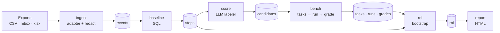

# Evenpoint — Technical Architecture

_Status: v0 implemented as described here. Companion to [overview.md](overview.md) (what and why), [class-diagram.md](class-diagram.md) (classes and modules) and [competitor-research.md](competitor-research.md) (landscape and roadmap)._

## Design principles

1. **Local-first.** One Python package, one DuckDB file per project. No server, no account, no telemetry.
2. **Measure, don't guess.** Deterministic numbers (process mining) come first. LLMs are used only to label steps and to be tested.
3. **Every number is traceable.** Every prompt, output, grade and price used ends up in the same DuckDB file, so a report can be audited or reproduced.
4. **Reuse before building.** DuckDB for storage and process mining (window functions), LiteLLM for model calls and prices. Evenpoint's own code is the glue, the scoring and the ROI.
5. **Stages are restartable.** Each stage reads tables and writes tables. A failed or changed stage reruns without redoing the earlier ones.

## Tech stack

| Concern | Choice | Why |
|---|---|---|
| Language | Python 3.11+, packaged with `uv` | DuckDB and LiteLLM are Python-first |
| Storage + trace store | DuckDB (single file) | Fast SQL over CSV-sized data, zero setup |
| Process mining | DuckDB SQL (`lag()` over each case) | Directly-follows graph, step times, handoffs and rework are a few window functions; PM4Py can be added for conformance checking or variant analysis |
| Model calls | LiteLLM | One API for OpenAI, Anthropic, Gemini, Ollama |
| Pricing catalog | LiteLLM's model cost map, snapshotted into `run_meta` per run | Maintained upstream; snapshot keeps runs reproducible |
| Config | YAML (PyYAML) + dataclasses | Human-editable, no schema framework needed |
| CLI | argparse (stdlib) | Five commands don't need a framework |
| Report | Jinja2 (autoescaped) → single self-contained HTML file | PDF via the browser's print, no PDF library |
| PII redaction | Regex rules (email, phone, card, IBAN, secret URLs) + staff names from the actor column | Optional Presidio plug-in later if regex isn't enough |
| Stats | stdlib `random` | Bootstrap confidence intervals over ≤ a few hundred results |

Runtime dependencies: `duckdb`, `litellm`, `pyyaml`, `jinja2`. Deliberately **not** used in v0: pandas, numpy, PM4Py, a web framework, a task queue, an ORM, promptfoo (Node runtime for a Python tool), a hosted backend.

## Pipeline



Every box writes to the same project database: `.evenpoint/project.duckdb`.

## Repository layout

```
evenpoint/
├── pyproject.toml
├── evenpoint/
│   ├── cli.py            # argparse entry point: init, run, rerun, review, report
│   ├── config.py         # load + validate evenpoint.yaml into dataclasses
│   ├── db.py             # DuckDB connection, table DDL, run ids, stage clearing
│   ├── redact.py         # PII redaction rules
│   ├── adapters/
│   │   ├── __init__.py   # read(adapter, path, mapping) + default Zendesk/Jira column mappings
│   │   ├── tabular.py    # any CSV, wide (one row per case) or long (one row per event)
│   │   └── mbox.py       # email threads
│   ├── normalize.py      # ingest: adapters → redact → events table; data-quality summary
│   ├── baseline.py       # SQL: process map, step times, handoffs, rework
│   ├── llm.py            # the only module that calls LiteLLM; tests replace complete()
│   ├── score.py          # LLM step labeler + candidate ranking
│   ├── bench/
│   │   ├── tasks.py      # sample cases → test cases (+ cost estimate)
│   │   ├── runner.py     # resumable model calls, cost + latency capture
│   │   └── graders.py    # exact match, LLM judge, human CSV round trip
│   ├── roi.py            # per-model summaries, net hours, cost, payback, bootstrap ranges, verdicts
│   └── report/
│       ├── render.py
│       └── template.html.j2
├── bizbench/
│   └── support-triage/   # synthetic Zendesk-style export + config (first of 15–20)
├── tests/
└── docs/
```

## Data model (DuckDB)

All tables carry `run_id` so several runs can live in one project file and be compared.

```sql
-- 2. Normalize: the event log
events(
  run_id      TEXT,
  case_id     TEXT,      -- ticket id, issue key, deal id, email thread id
  activity    TEXT,      -- "created", "assigned", "first_reply", "tagged:billing", "solved"
  ts          TIMESTAMP,
  actor       TEXT,      -- redacted to a stable pseudonym (agent_017)
  source      TEXT,      -- zendesk | jira | mbox | csv
  payload     JSON       -- redacted case fields, on the case's first event only
)

-- 3. Baseline: one row per activity (step)
steps(
  run_id, activity,
  volume_per_month     DOUBLE,
  median_minutes       DOUBLE,  -- time spent in the step, from timestamps or config override
  minutes_source       TEXT,    -- 'timestamps' | 'config' (estimated by the user)
  handoff_rate         DOUBLE,
  rework_rate          DOUBLE,
  baseline_hours_month DOUBLE   -- volume × minutes / 60
)

edges(run_id, source_activity, target_activity, n)   -- directly-follows graph

-- 4. AI-fit scoring
candidates(
  run_id, activity,
  repetitive INT, structured INT, risk INT,   -- 1–5 rubric
  task_type      TEXT,   -- classify | extract | draft
  input_field    TEXT,   -- payload field the AI reads
  expected_field TEXT,   -- payload field holding what the person produced
  fit_score      DOUBLE,
  rank           INT,
  testable       BOOLEAN,  -- false when no field holds the person's output, or risk = 5
  reason         TEXT
)

-- 5. Benchmark
tasks(run_id, task_id, activity, case_id, task_type, input TEXT, expected TEXT, prompt TEXT)
runs(run_id, kind TEXT,                      -- kind: label | task | judge
     task_id, model, prompt TEXT, output TEXT,
     input_tokens INT, output_tokens INT, cost_usd DOUBLE,
     latency_ms INT, error TEXT, created_at TIMESTAMP)
grades(run_id, task_id, model, grader TEXT, passed BOOL, score DOUBLE, note TEXT)

-- 6. ROI
roi(run_id, activity, model, mode,           -- mode: auto | draft_review
    accuracy DOUBLE,
    net_hours_month DOUBLE, net_hours_low DOUBLE, net_hours_high DOUBLE,
    net_value_month DOUBLE, net_value_low DOUBLE,
    ai_cost_month DOUBLE, payback_months DOUBLE,
    verdict TEXT, reason TEXT)               -- verdict: automate | review | dont_automate

-- Reproducibility
run_meta(run_id, started_at, config_yaml TEXT, pricing_snapshot JSON, evenpoint_version TEXT)
```

The `runs` + `grades` tables **are** the trace store from the v0 diagram: every labeler, task and judge call is in `runs`.

## Stage details

### 1. Ingest

```python
adapters.read(adapter, path, mapping) -> list[dict]  # {case_id, activity, ts, actor, payload}
```

- `tabular` reads any CSV in one of two shapes. **Wide** (one row per case): `timestamps: {activity: column}`, and each filled timestamp cell becomes an event. **Long** (one row per event): `activity` and `ts` columns. `fields: {name: column}` picks the text fields kept for benchmark tasks.
- `zendesk` and `jira` are default mappings for `tabular` (usual export headers). Any key set in `evenpoint.yaml` replaces the default for that key.
- **Known limit:** a plain Zendesk ticket CSV has one row per ticket, so events come from its timestamp columns (`created`, `assigned`, `solved`). Full per-event history needs the audit export, which works today as a long CSV.
- `mbox`: a thread (root of `References`, else `In-Reply-To`) is a case; each message is a `customer_message` or `team_reply` event, told apart by the `team` mapping (addresses or `@domains`). The first customer message and first team reply become the `text` and `reply` fields.
- Redaction runs inside ingest, before anything is written to DuckDB. Actors become salted-hash pseudonyms (`actor_1a2b3c4d`) and their names are scrubbed from text. Raw exports are never copied into the project file.

### 2. Normalize

`normalize.ingest` writes `events`. `quality_summary` (events, cases, single-event cases, cases without text, date range) goes into the report with warnings when over half the cases have one event or no text, or there are fewer than 100 cases.

### 3. Baseline

SQL over `events` with `lag()` per case:

- previous activity → directly-follows graph (`edges`)
- time since the previous event → `median_minutes`
- actor change from the previous event → `handoff_rate`
- activity repeated within a case → `rework_rate`
- volume per month = count ÷ months between first and last event

Step duration from timestamps includes waiting time, which overstates work time. `steps.<name>.minutes` in `evenpoint.yaml` overrides it, and `minutes_source` records which one was used.

### 4. AI-fit scoring

For each step with at least `min_volume_per_month`, the labeler gets the step's stats, the list of payload fields, and 8 redacted sample cases. It returns:

```json
{"repetitive": 4, "structured": 5, "risk": 2, "task_type": "classify",
 "input_field": "text", "expected_field": "group", "reason": "..."}
```

`fit_score = baseline_hours_month × (repetitive + structured)/10 × (1 − (risk−1)/4)`. A step is **testable** only if both fields exist and differ, and risk < 5. `steps.<name>.task_type / input / expected` override the labeler. Invalid labeler replies skip the step with a warning.

### 5. Benchmark

**Ground truth is what the humans actually did**, which is what makes the test "on your own data":

| task_type | input | expected | grader |
|---|---|---|---|
| classify | e.g. first message | label a person set (prompt lists the 50 most common values) | exact match after normalizing case, whitespace, quotes |
| extract | message or record | value a person filled in | exact match |
| draft | e.g. first message | the reply a person sent | LLM judge (correct, complete enough, safe) |

- **Sampling:** the top `max_candidates` testable steps, `tasks_per_candidate` cases each, random with a fixed seed. `few_shot` examples come from other cases, never the test ones.
- **Cost estimate first:** prompt length ÷ 4 × price, per model, plus judge calls. Above `max_cost_usd`, the CLI asks (or needs `--yes` when not interactive).
- **Runner:** thread pool (`workers`), LiteLLM retries, every call written to `runs` as it finishes, including failures. Re-running skips (task, model) pairs already done, so an interrupted run resumes.
- **Human spot-check:** `evenpoint review export` writes N outputs per model to CSV; the user fills `pass` with yes/no; `review import` stores `grader='human'` grades, which override automatic ones, and refreshes the report. The judge's agreement with humans is shown per model.
- **Per model:** accuracy, cost per task, cost per successful task, p50/p95 latency, error rate.

### 6. ROI engine

For each tested step × model × mode:

```
net_hours_month = volume × (baseline_minutes − review_minutes(mode)) / 60
                − volume × (1 − accuracy) × failure_minutes / 60
ai_cost_month   = volume × cost_per_task
net_value_month = net_hours_month × hourly_rate − ai_cost_month
payback_months  = setup_cost / net_value_month   (only when positive)
```

- **Modes:** `auto` (no review; failures cost `failure_minutes`) and `draft_review` (a person checks every output for `review_minutes.draft_review`).
- **Range:** bootstrap over the task results (1,000 resamples) gives a 95% interval for accuracy, hence `net_hours_low/high` and `net_value_low`.
- **Verdict:** `dont_automate` if risk is 5 or the low-end value is below zero; otherwise `automate` for the auto row and `review` for the draft-and-review row. The report recommends the best row per step.

### 7. Outputs

- `report.html`: single file, inline CSS, no external requests, light and dark. Sections: headline numbers, recommendations, don't-automate list, model comparison, all ROI options, candidates, baseline and process map, data quality, assumptions, privacy and call log.
- PDF = browser print of the same HTML.
- **Web demo:** the bizbench report rendered as a static page. No backend, no sign-up.

## Configuration

```yaml
# evenpoint.yaml (paths are relative to this file)
project: acme-support
hourly_rate: 35            # USD per hour, fully loaded

sources:
  - adapter: zendesk       # csv | zendesk | jira | mbox
    path: exports/tickets.csv
    mapping:               # only keys that differ from the adapter's defaults
      fields: { text: Description, group: Group, reply: Public reply }

steps:                     # optional, per step
  assigned: { minutes: 2, task_type: classify, input: text, expected: group }
  solved:   { minutes: 8, task_type: draft, input: text, expected: reply }

models:                    # any LiteLLM model string
  - anthropic/claude-haiku-5-5
  - openai/gpt-5.4-mini
  - ollama/llama3.2

labeler_model: anthropic/claude-haiku-5-5
judge_model: anthropic/claude-sonnet-5-5

bench:
  tasks_per_candidate: 50
  few_shot: 3
  max_cost_usd: 10         # ask before exceeding
  seed: 42
  workers: 4

review_minutes:            # human minutes per AI output, by mode
  auto: 0
  draft_review: 1.5
failure_minutes: 10        # minutes to fix a wrong output
setup_cost_usd: 2000       # one-off cost to put automation in place
min_volume_per_month: 20   # ignore rarer steps
max_candidates: 5          # benchmark at most this many steps
```

API keys come from environment variables (`OPENAI_API_KEY`, `ANTHROPIC_API_KEY`, ...), as LiteLLM expects. They are never written to config or DuckDB.

## CLI

```
evenpoint init EXPORT --adapter zendesk   # write evenpoint.yaml with that adapter's default mapping
evenpoint run [--yes]                     # new run, all stages, writes report.html
evenpoint run --from bench                # redo one stage onward on the latest run
evenpoint rerun --models a,b              # run saved test cases on new models, refresh the report
evenpoint review export [review.csv]      # human spot-check round trip
evenpoint review import review.csv
evenpoint report                          # re-render report.html from stored tables
```

All commands take `-c path/to/evenpoint.yaml`. Stages: `ingest, baseline, score, bench, grade, roi, report`.

## Privacy and security

- Redaction happens at ingest; un-redacted text never reaches DuckDB or a model.
- Data goes only to the model providers listed in config. Ollama-only runs send nothing off the machine.
- The report states which providers received data, with call counts and cost per model.
- Keep `.evenpoint/` and raw exports out of git (this repo's `.gitignore` does).
- Redaction is regex-based and will miss things. The docs and the report say so plainly, and recommend local models for sensitive data.

## Testing

- `bizbench/support-triage` doubles as the integration test (`tests/test_pipeline.py`): full run, rerun on a new model, human review round trip and stage restart, with a fake model.
- Unit tests only where logic is non-trivial: adapters, redaction rules, baseline SQL, task sampling, runner resume, graders, ROI formula and bootstrap.
- Tests replace `evenpoint.llm.complete`, so they never hit the network. Run with `uv run pytest`.

## Deferred (and when to add)

| Item | Add when |
|---|---|
| Live API connectors (Zendesk, Jira, HubSpot) | Users ask to skip the export step |
| Presidio / NER redaction | Regex misses show up in real exports |
| Multi-step / tool-using tasks | Top candidates need lookups to be done |
| MCP server over the DuckDB file | v1, after the report format settles |
| Opt-in shared benchmark | v1, once bizbench has users |
| Hosted version | Never for v0; local-first is the pitch |
| PM4Py (variants, conformance checking) | Users want more than the directly-follows graph |
| Sampling stratified by process variant | Rare variants get missed in the random sample |
| `init` guessing CSV column mappings with an LLM | Mapping by hand is the main setup complaint |
| Triage mode (AI routes, person does the work) | A real workflow needs it as a separate ROI line |
| Multi-field extract tasks with a JSON schema grader | Extraction steps with several fields show up |

## Open decisions

1. **Licence:** `pyproject.toml` says Apache 2.0 (patent grant); switch to MIT if preferred, and add a LICENSE file either way.
2. **First adapter to polish:** Zendesk (biggest market, but now competes with Zendesk's own report) vs Jira/email (no native competitor).
3. **Default judge model:** a strong model costs more per run but gives judgments people trust; measure agreement with human spot-checks on bizbench before choosing.
