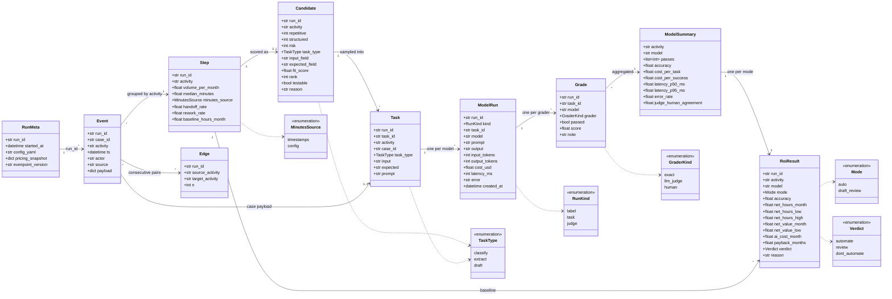
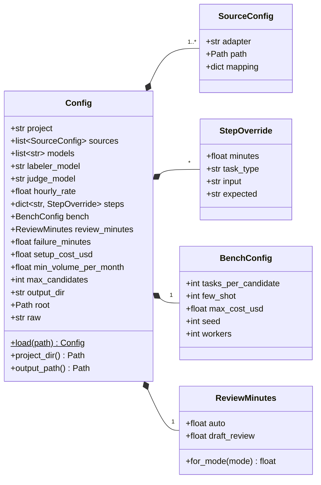
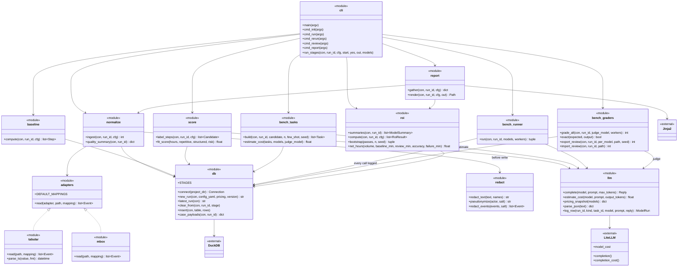

# Evenpoint — Class Diagram

_Companion to [architecture.md](architecture.md). Evenpoint is mostly plain functions over DuckDB tables, so the "classes" here are dataclasses (config), records (table rows, passed around as dicts), enums, and modules shown as `<<module>>` with their public functions. Matches the v0 code._

Three views:

1. [Domain records](#1-domain-records): what each pipeline stage produces (the DuckDB tables).
2. [Configuration](#2-configuration): `evenpoint.yaml` as dataclasses (`evenpoint/config.py`).
3. [Modules](#3-modules): which code produces and consumes which records.

## 1. Domain records

`ModelSummary` is computed by `roi.summaries()` (SQL), not stored. Everything else is a DuckDB table. Labeler and judge calls are `ModelRun` rows too (`kind = label | judge`), so every model call is in the trace store.

## 2. Configuration

API keys are not part of `Config`; LiteLLM reads them from environment variables.

## 3. Modules

`adapters <|.. tabular` means both readers return the same event shape; there is no base class, and the `zendesk` and `jira` adapters are default mappings for `tabular`. `bench_tasks`, `bench_runner` and `bench_graders` are `bench/tasks.py`, `bench/runner.py` and `bench/graders.py` (Mermaid doesn't allow dots in names). `llm` is the only module that talks to model providers; tests replace `llm.complete`.
